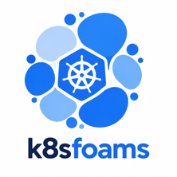
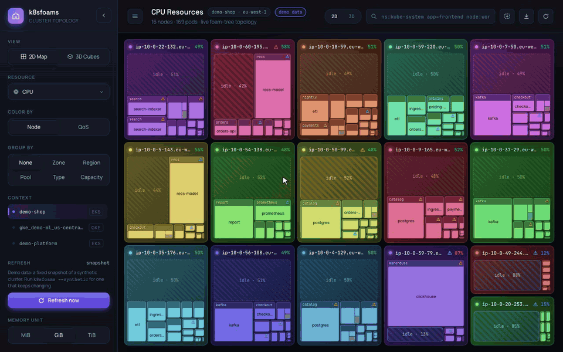

# k8s-pod-foamtree

<p align="center">
  
</p>

**k8sfoams** is a local, read-only dashboard. It answers one question: *where is my cluster's requested CPU and memory actually going, and how much room is left on each node?*

It shows **resource requests** (what the scheduler reserves), not live usage. Use it to find pods that request too much and idle headroom. It is not a performance monitor. It runs on your laptop and reads *~/.kube/config* (or `$KUBECONFIG`) with the standard Kubernetes client. It needs no in-cluster deployment and no metrics-server.

**[Documentation](https://mmpyro.github.io/k8s-pod-foamtree/)** · **[Live demo](https://mmpyro.github.io/k8s-pod-foamtree/demo/)**: the real dashboard on synthetic clusters, in your browser.



*A one-minute tour on the [synthetic demo clusters](https://mmpyro.github.io/k8s-pod-foamtree/synthetic-mode/). Run it yourself with `k8sfoams --synthetic`.*

## Features

- **[2D map](https://mmpyro.github.io/k8s-pod-foamtree/map-2d/)** and **[3D cubes](https://mmpyro.github.io/k8s-pod-foamtree/cubes-3d/)** of every node and pod, sized by requests.
- **[Node health](https://mmpyro.github.io/k8s-pod-foamtree/node-health/)**: the map hatches free capacity on cordoned, NotReady, pressured or tainted nodes, because that capacity is not really free.
- **[Topology](https://mmpyro.github.io/k8s-pod-foamtree/topology/)**: group nodes by zone, region, node pool, instance type or spot / on-demand.
- **[Audit & hygiene](https://mmpyro.github.io/k8s-pod-foamtree/audit/)**: missing requests or limits, monoliths, naked pods, single replicas, replicas sharing one node, zone or spot pool.
- **[QoS & eviction risk](https://mmpyro.github.io/k8s-pod-foamtree/qos/)**: color pods by QoS class.
- **[Scheduling simulators](https://mmpyro.github.io/k8s-pod-foamtree/simulators/)**: "Can I fit this pod?", "What happens if I drain this node?", "Which nodes could be removed?", "Can I scale this workload by N replicas?" and "Do the pending pods fit?", with hypothetical nodes to try node shapes before you add them.
- **[Filtering](https://mmpyro.github.io/k8s-pod-foamtree/filtering/)**: a query bar that highlights matching pods by namespace, label, QoS, node, topology or finding.
- **[Extended resources](https://mmpyro.github.io/k8s-pod-foamtree/extended-resources/)**: GPUs, ephemeral storage and HugePages, with fragmentation and stranded devices.
- **[Export](https://mmpyro.github.io/k8s-pod-foamtree/export/)** to PNG, SVG, JSON or CSV, and **[shareable links](https://mmpyro.github.io/k8s-pod-foamtree/shareable-links/)** to any view.
- **Live updates** from a watch cache, so scaling a Deployment shows up within seconds.
- **[AI advisor](https://mmpyro.github.io/k8s-pod-foamtree/advisor/)** (optional): with an OpenAI-compatible key (or a local Ollama model), it gives prioritised recommendations with YAML / `kubectl` fixes. Its chat answers questions about k8sfoams and the cluster on screen. It is off by default. It shows what it sends before it sends it, and it can redact names.

## Installation

```bash
pip install k8sfoams
# or with uv
uv pip install k8sfoams
```

To install from source, see [Getting started](https://mmpyro.github.io/k8s-pod-foamtree/getting-started/).

## Run

```bash
k8sfoams              # your kubeconfig contexts, at http://127.0.0.1:8080
k8sfoams --synthetic  # no cluster needed: generated demo clusters that keep changing
```

For CI and cron, `report` writes the same JSON / CSV export without the dashboard. It can also fail the job on a policy:

```bash
k8sfoams report --context prod --format csv --output prod.csv
k8sfoams report --context prod --fail-on audit:missing-requests,health:not-ready  # exit 1 when violated
```

A context switch in the dashboard never changes your kubeconfig. The [command-line reference](https://mmpyro.github.io/k8s-pod-foamtree/cli/) lists every option, the [report](https://mmpyro.github.io/k8s-pod-foamtree/cli/#report) exit codes and a GitHub Actions example. [Synthetic mode](https://mmpyro.github.io/k8s-pod-foamtree/synthetic-mode/) describes what the demo clusters contain.

## Security

- Listens on `127.0.0.1` by default. Requests with an unknown `Host` header (DNS rebinding) or a cross-site `Origin` get `403`.
- With `--host 0.0.0.0` (or any non-loopback address), it warns at startup and requires a token. It prints the token in the startup URL (`http://host:8080/#token=…`). Use `--token` to choose the token and `--no-auth` to opt out. Use `--allowed-host NAME` for each name you open it by.
- It only reads the cluster, with your kubeconfig credentials, and never changes it.

See [Network access](https://mmpyro.github.io/k8s-pod-foamtree/cli/#network-access).

## Development

```bash
make restore_dev     # install with dev dependencies
make run-synthetic   # build the UI and run on the synthetic clusters
make tests           # type checking, linting, security, unit tests
make docs-serve      # the docs site with live reload
```

See [Development](https://mmpyro.github.io/k8s-pod-foamtree/development/) for the frontend build, the docs and the CI targets.
