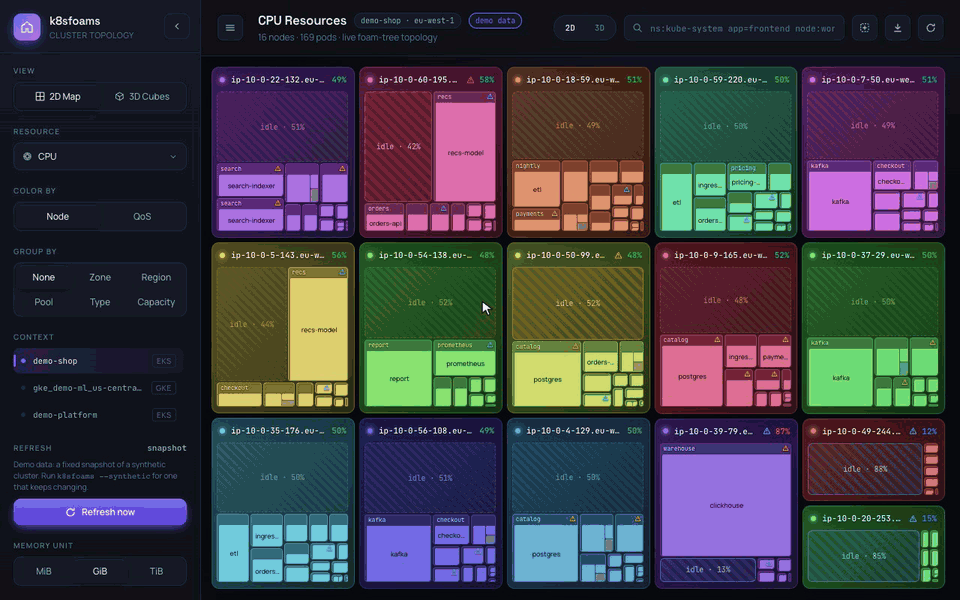

# k8s-pod-foamtree

<p align="center">
  
</p>

**k8sfoams** is a local, read-only dashboard that answers one question: *where is my cluster's requested CPU and memory actually going, and how much room is left on each node?*

It visualizes **resource requests** — what the scheduler reserves — not live usage. That makes it a tool for spotting over-requesting pods and idle headroom, not a performance monitor. It runs on your laptop, reads *~/.kube/config* (or `$KUBECONFIG`) with the standard Kubernetes client, and needs no in-cluster deployment and no metrics-server.

**[Documentation](https://mmpyro.github.io/k8s-pod-foamtree/)** · **[Live demo](https://mmpyro.github.io/k8s-pod-foamtree/demo/)** — the real dashboard on synthetic clusters, in your browser.



*A one-minute tour on the [synthetic demo clusters](https://mmpyro.github.io/k8s-pod-foamtree/synthetic-mode/) — run it yourself with `k8sfoams --synthetic`.*

## Features

- **[2D map](https://mmpyro.github.io/k8s-pod-foamtree/map-2d/)** and **[3D cubes](https://mmpyro.github.io/k8s-pod-foamtree/cubes-3d/)** of every node and pod, sized by requests.
- **[Node health](https://mmpyro.github.io/k8s-pod-foamtree/node-health/)**: free capacity on cordoned, NotReady, pressured or tainted nodes is hatched, because it is not really free.
- **[Topology](https://mmpyro.github.io/k8s-pod-foamtree/topology/)**: group nodes by zone, region, node pool, instance type or spot / on-demand.
- **[Audit & hygiene](https://mmpyro.github.io/k8s-pod-foamtree/audit/)**: missing requests or limits, monoliths, naked pods, single replicas, replicas sharing one node, zone or spot pool.
- **[QoS & eviction risk](https://mmpyro.github.io/k8s-pod-foamtree/qos/)**: color pods by QoS class.
- **[Scheduling simulators](https://mmpyro.github.io/k8s-pod-foamtree/simulators/)**: "Can I fit this pod?", "What happens if I drain this node?", "Which nodes could be removed?" and "Can I scale this workload by N replicas?".
- **[Filtering](https://mmpyro.github.io/k8s-pod-foamtree/filtering/)**: a query bar that highlights matching pods by namespace, label, QoS, node, topology or finding.
- **[Extended resources](https://mmpyro.github.io/k8s-pod-foamtree/extended-resources/)**: GPUs, ephemeral storage and HugePages, with fragmentation and stranded devices.
- **[Export](https://mmpyro.github.io/k8s-pod-foamtree/export/)** to PNG, SVG, JSON or CSV, and **[shareable links](https://mmpyro.github.io/k8s-pod-foamtree/shareable-links/)** to any view.
- **Live updates** from a watch cache, so scaling a Deployment shows up within seconds.

## Installation

```bash
pip install k8sfoams
# or with uv
uv pip install k8sfoams
```

To install from source, see [Getting started](https://mmpyro.github.io/k8s-pod-foamtree/getting-started/).

## Run

```bash
k8sfoams              # your kubeconfig contexts, at http://127.0.0.1:8080
k8sfoams --synthetic  # no cluster needed: generated demo clusters that keep changing
```

Switching context in the dashboard never modifies your kubeconfig. See the [command-line reference](https://mmpyro.github.io/k8s-pod-foamtree/cli/) for every option and [Synthetic mode](https://mmpyro.github.io/k8s-pod-foamtree/synthetic-mode/) for what the demo clusters contain.

## Development

```bash
make restore_dev     # install with dev dependencies
make run-synthetic   # build the UI and run on the synthetic clusters
make tests           # type checking, linting, security, unit tests
make docs-serve      # the docs site with live reload
```

See [Development](https://mmpyro.github.io/k8s-pod-foamtree/development/) for the frontend build, the docs and the CI targets.
