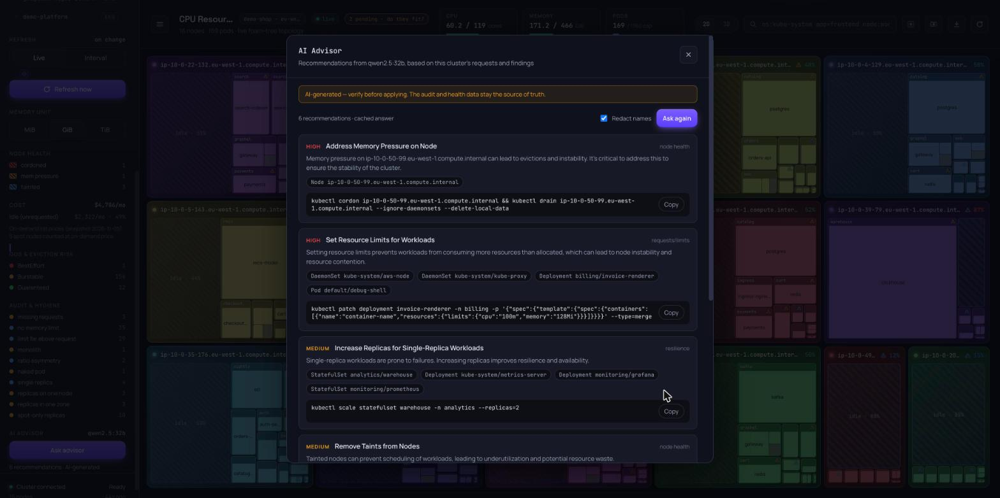

# AI advisor

The optional **AI Advisor** sends a compact summary of the current context to an LLM. It shows the answer as prioritised
recommendations: what to change in requests and limits, resilience, scheduling constraints, node health, node pools
and cost, each with a concrete YAML snippet or `kubectl` command.



The dashboard already shows *what* is wrong. The advisor explains *why it matters* and *what to change*. It works from
the same [audit](audit.md) and [node health](node-health.md) data, and that data stays the source of truth. Rules:

- **Off by default.** Without an API key the panel is hidden, and nothing leaves your machine.
- **Read-only.** The advisor only suggests. It never applies a change, and k8sfoams still never writes to the cluster.
- **Consent first.** The first ask in a page load shows exactly what will be sent. Nothing is sent before you press
  **Send**.

## Enable it

```bash
pip install 'k8sfoams[advisor]'          # the openai client, optional
export OPENAI_API_KEY=sk-...
k8sfoams
```

| Variable | Default | Meaning |
| --- | --- | --- |
| `OPENAI_API_KEY` | none: advisor off | API key of an OpenAI or OpenAI-compatible endpoint |
| `OPENAI_BASE_URL` | OpenAI | base URL of an OpenAI-compatible endpoint (Ollama, vLLM, Azure OpenAI, …) |
| `K8SFOAMS_ADVISOR_MODEL` | `gpt-4o-mini` | model name |

The key is read from the environment only. A command-line flag would leak it into shell history and `ps`. It stays on
the server: the browser only learns whether the advisor is on and which model it uses.

### A local model with Ollama

Nothing leaves your machine:

```bash
ollama pull qwen2.5:32b
OPENAI_API_KEY=ollama OPENAI_BASE_URL=http://localhost:11434/v1 K8SFOAMS_ADVISOR_MODEL=qwen2.5:32b k8sfoams
```

Ollama ignores the key, but one must be set. The model needs JSON-schema structured output. Local models are slow: a
32B model on a laptop GPU takes about 3–5 minutes per answer. The request is given up to 10 minutes.

## What is sent

One system prompt and one JSON summary of the context, about 2–3k tokens on any cluster size. It is built from the
same data as the dashboard, and needs no extra calls to the cluster:

- totals and allocation (requested vs allocatable CPU and memory, hourly cost) per node pool and per zone
- node warnings (cordoned, NotReady, pressure, taints, stranded devices) with up to 10 node names each
- audit findings with the count of pods and the 10 workloads most affected by each
- the QoS mix and the namespaces with the most BestEffort / Burstable pods
- per device resource (GPUs): allocatable, requested, and how the free units are spread over nodes
- the 10 namespaces requesting the most CPU

Labels, annotations, images, environment variables and anything else from pod specs are never sent.

**Redact names**, on by default, replaces node, node pool, namespace and workload names with stable placeholders
(`node-3`, `pool-1`, `ns-2`, `workload-7`). The mapping stays on the server, which turns the placeholders in the answer
back into real names. **Highlight** therefore works the same either way.

The consent step shows the messages exactly as they will be sent. The data comes from the cluster at that moment, so
on a changing cluster, the summary sent on **Send** can differ slightly from the preview.

## Recommendations

Cards are sorted by severity (high, medium, low) and carry a category. Each affected object is a chip:

- a workload chip **pins** the workload, as a click on one of its pods does
- a node, node pool or namespace chip sets the `node:`, `pool:` or `ns:` [query](filtering.md)

**Copy** puts the suggested change on the clipboard. Every answer is marked *AI-generated — verify before applying*.

The last answer per context is cached on the server. Asking again while the cluster is unchanged returns it
immediately and spends no tokens. A changed cluster produces a new summary, and a new request.

Errors from the provider come back as a message in the panel, and nothing is retried automatically. These are an
invalid key (`401`), a rate limit (`429`), a timeout (`504`), an unreachable endpoint or malformed model output
(`502`).

The [live demo](demo/index.html) has no server and no LLM, so the panel is hidden there. See
[HTTP API](http-api.md) for the endpoints.
