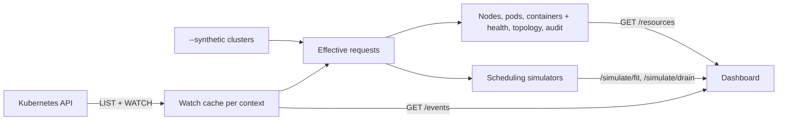

# How it works

## Listing the cluster

k8sfoams lists nodes and all non-terminated pods. It leaves out pods in `Succeeded` or `Failed`. These pods still
report requests through the API, but they no longer reserve anything.

The first request for a context lists both in pages (`--page-size`, 500 by default). Then k8sfoams keeps the result
current in memory with a WATCH. Refreshes and simulations read that cache. Once the cache is warm, they make no API
calls, however large the cluster.

A context's cache stops after 15 minutes without requests. An open tab in Live mode counts as a request. If the API server becomes unreachable, the dashboard shows the error instead of stale data. With
`--no-watch`, k8sfoams lists on every request instead.

## Effective requests

k8sfoams parses quantities with the Kubernetes client's `parse_quantity`: CPU to millicores, memory to decimal kB.

A pod's **effective request** is `max(sum(regular containers), max(init containers))`. Init containers run one after
another, so k8sfoams takes their maximum, not their sum. Native sidecars (init containers with `restartPolicy: Always`)
keep running. So they count as regular containers, and they add to every init container that starts after them. The
scheduler reserves this same amount.

Node sizes come from `status.allocatable`, not capacity. So the map never draws kube- and system-reserved capacity as
free space.

## The payload

The result is nested node → pod → container, with CPU, memory and extended requests side by side.
[`GET /resources`](http-api.md) serves it as JSON. Each node also carries its [health](node-health.md) and
[topology](topology.md). Each pod carries its QoS class, labels, owner and [audit findings](audit.md).

The dashboard is a React single-page app. esbuild compiles its `.jsx` files and bundles React into one `bundle.js`.
The Python package ships that file, so the dashboard loads no script from a CDN. The dashboard fetches every resource
of the context in one call, then renders it.

## Live updates

By default the view is *Live*. It keeps a Server-Sent Events stream open (`GET /events?context=`). The server sends a
`changed` event whenever the context's watch cache changes, at most once per second. The browser then fetches again,
so a Deployment you scale shows up within a few seconds.

A change counts only if it alters what the dashboard shows. Status updates that leave the requests, labels and
conditions the same don't trigger an event. While the stream reconnects, or when there is no stream (`--no-watch`), the
view polls every 60 seconds by default instead.

In [synthetic mode](synthetic-mode.md) the generated clusters feed the same stream, so the live view behaves as it does
against a watched cluster.
