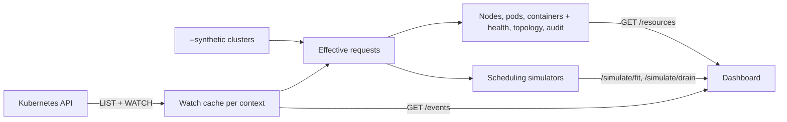

# How it works

## Listing the cluster

k8sfoams lists nodes and all non-terminated pods. Pods in `Succeeded` or `Failed` are left out: they still report
requests through the API but no longer reserve anything.

The first request for a context lists both in pages (`--page-size`, 500 by default), then keeps the result current in
memory with a WATCH. Refreshes and simulations read that cache, so once it is warm they make no API calls, however large
the cluster. A context's cache stops after 15 minutes without requests; an open tab in Live mode counts as a request.
If the API server becomes unreachable, the dashboard shows the error instead of stale data. `--no-watch` lists on
every request instead.

## Effective requests

Quantities are parsed with the Kubernetes client's `parse_quantity`: CPU to millicores, memory to decimal kB.

A pod's **effective request** is `max(sum(regular containers), max(init containers))`. Init containers run one after
another, so they are maxed, not summed. Native sidecars (init containers with `restartPolicy: Always`) keep running, so
they count as regular containers and add to every init container started after them. This is what the scheduler
actually reserves.

Node sizes come from `status.allocatable`, not capacity, so kube- and system-reserved capacity is never drawn as free
space.

## The payload

The result is nested node → pod → container, with CPU, memory and extended requests side by side, and served as JSON
from [`GET /resources`](http-api.md). Each node also carries its [health](node-health.md) and
[topology](topology.md); each pod its QoS class, labels, owner and [audit findings](audit.md).

The dashboard is a React single-page app. esbuild compiles its `.jsx` files and bundles React into one `bundle.js`,
which the Python package ships, so no script is loaded from a CDN. It fetches every resource of the context in one
call and renders.

## Live updates

By default the view is *Live*. It keeps a Server-Sent Events stream open (`GET /events?context=`), and the server sends
a `changed` event whenever the context's watch cache changes, at most once per second. The browser then fetches again,
so scaling a Deployment shows up within a few seconds.

A change counts only if it alters what the dashboard shows. Status updates that leave the requests, labels and
conditions the same don't trigger it. While the stream is reconnecting, or when there is none (`--no-watch`), the view
polls every 60 seconds by default instead.

In [synthetic mode](synthetic-mode.md) the generated clusters feed the same stream, so the live view behaves as it does
against a watched cluster.
