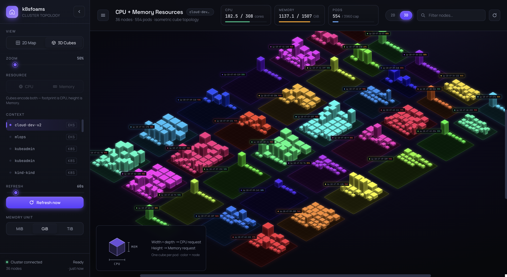

# 3D cubes

An isometric view: one plate per node, one cube per pod. A cube shows both resources at once:

- **width × depth** (footprint) → CPU request
- **height** → memory request
- **color** → node

Both dimensions use a square-root scale, so a 10× larger pod is not 10× wider. A cube already shows both resources.
So the 3D view disables the CPU/Memory picker and shows a **Zoom** slider in its place.

<figure class="k8sfoam-embed k8sfoam-embed-tall">
  <iframe src="../demo/index.html?embed=1#ctx=arn:aws:eks:us-east-1:000000000000:cluster/demo-platform&view=3d" loading="lazy" title="k8sfoams 3D view of a 102-node cluster"></iframe>
  <figcaption>
    The 102-node demo-platform cluster in 3D. Drag to orbit, scroll to zoom, hover a cube for its pod.
    <a href="../demo/index.html#ctx=arn:aws:eks:us-east-1:000000000000:cluster/demo-platform&view=3d" target="_blank">Open full screen</a>
  </figcaption>
</figure>

Switch views with the sidebar *View* control or the `2D`/`3D` pill in the header. The view is client-side state, so
you need no flag and no restart. k8sfoams draws the scene with WebGL (three.js), so it stays smooth with thousands of
pods. Drag to orbit. Scroll or use the slider to zoom. Hover a cube for its pod, and click a plate for its node. If
WebGL is turned off, the 3D view says so, and the 2D map shows the same data.

[Try it grouped by capacity type](demo/index.html#ctx=arn:aws:eks:us-east-1:000000000000:cluster/demo-platform&view=3d&groupBy=capacityType){ .k8s-try target=_blank }
· [colored by QoS](demo/index.html#ctx=arn:aws:eks:us-east-1:000000000000:cluster/demo-platform&view=3d&colorBy=qos){ .k8s-try target=_blank }

