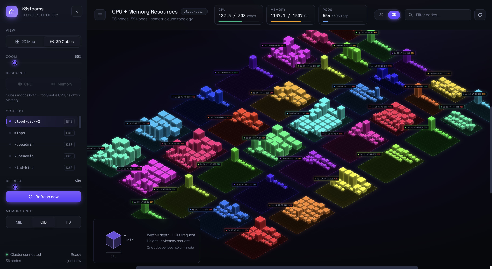

# 3D cubes

An isometric view: one plate per node, one cube per pod. A cube encodes both resources at once:

- **width × depth** (footprint) → CPU request
- **height** → memory request
- **color** → node

Both dimensions are square-root scaled, so a 10× larger pod is not 10× wider. Because a cube already shows both
resources, the CPU/Memory picker is disabled in 3D and a **Zoom** slider takes its place.

<figure class="k8sfoam-embed k8sfoam-embed-tall">
  <iframe src="../demo/index.html?embed=1#ctx=arn:aws:eks:us-east-1:000000000000:cluster/demo-platform&view=3d" loading="lazy" title="k8sfoams 3D view of a 102-node cluster"></iframe>
  <figcaption>
    The 102-node demo-platform cluster in 3D. Drag to orbit, scroll to zoom, hover a cube for its pod.
    <a href="../demo/index.html#ctx=arn:aws:eks:us-east-1:000000000000:cluster/demo-platform&view=3d" target="_blank">Open full screen</a>
  </figcaption>
</figure>

Switch views with the sidebar *View* control or the `2D`/`3D` pill in the header. It is client-side state: no flag, no
restart. The scene is drawn with WebGL (three.js), so it stays smooth with thousands of pods: drag to orbit, scroll or
use the slider to zoom, hover a cube for its pod, click a plate for its node. Where WebGL is turned off the 3D view
says so, and the 2D map shows the same data.

[Try it grouped by capacity type](demo/index.html#ctx=arn:aws:eks:us-east-1:000000000000:cluster/demo-platform&view=3d&groupBy=capacityType){ .k8s-try target=_blank }
· [colored by QoS](demo/index.html#ctx=arn:aws:eks:us-east-1:000000000000:cluster/demo-platform&view=3d&colorBy=qos){ .k8s-try target=_blank }

