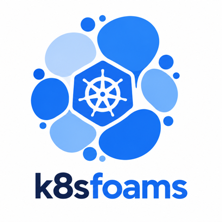

---
hide:
  - navigation
  - toc
---

<div class="k8s-hero" markdown>

{ width="96" }

# k8sfoams

**Where is your cluster's requested CPU, memory and GPU actually going, and how much room is left on each node?**

[Try the live demo](demo/index.html){ .md-button .md-button--primary }
[Get started](getting-started.md){ .md-button }

</div>

k8sfoams is a local, read-only dashboard for Kubernetes. It draws every node as a box and every pod as a foam
sized by its **resource requests**: what the scheduler reserves, not live usage. That makes it a tool for spotting
over-requesting pods and idle headroom, not a performance monitor. It runs on your laptop, reads `~/.kube/config`
(or `$KUBECONFIG`) with the standard Kubernetes client, and needs no in-cluster deployment and no metrics-server.

The dashboard below is the real thing, running on a synthetic cluster in your browser. Click a node to see its pods
and simulate a drain, hover a pod, type `audit:spof-zone` into the query bar, or switch to the 3D view.

<figure class="k8sfoam-embed k8sfoam-embed-tall">
  <iframe src="demo/index.html?embed=1" loading="lazy" title="k8sfoams live demo on a synthetic EKS cluster"></iframe>
  <figcaption>
    A synthetic EKS web shop: 16 nodes over three zones, about 170 pods.
    <a href="demo/index.html" target="_blank">Open full screen</a>
  </figcaption>
</figure>

## What it shows

<div class="grid cards" markdown>

-   :material-view-dashboard-outline: **[2D map](map-2d.md) and [3D cubes](cubes-3d.md)**

    A squarified treemap of nodes and pods, or an isometric cube per pod with CPU as footprint and memory as height.

-   :material-heart-pulse: **[Node health](node-health.md)**

    Free capacity on a cordoned, NotReady, pressured or tainted node is hatched, because it is not really free.

-   :material-earth: **[Topology](topology.md)**

    Box nodes by zone, region, node pool, instance type or spot / on-demand to see where capacity is uneven.

-   :material-clipboard-check-outline: **[Audit & hygiene](audit.md)**

    Missing requests or limits, monoliths, naked pods, single replicas and replicas sharing one node, zone or spot pool.

-   :material-shield-half-full: **[QoS & eviction risk](qos.md)**

    Color pods by QoS class to see what the kubelet evicts first under memory pressure.

-   :material-calculator-variant-outline: **[Scheduling simulators](simulators.md)**

    "Can I fit this pod?" and "What happens if I drain this node?", answered against free allocatable capacity.

-   :material-filter-variant: **[Filtering](filtering.md)**

    A query bar that highlights matching pods and dims the rest: namespaces, labels, QoS, nodes, findings.

-   :material-expansion-card-variant: **[Extended resources](extended-resources.md)**

    GPUs, ephemeral storage and HugePages get their own map, with fragmentation and stranded devices called out.

</div>

## Quick start

```bash
pip install k8sfoams
k8sfoams              # your kubeconfig contexts, at http://127.0.0.1:8080
k8sfoams --synthetic  # no cluster needed: the demo clusters, changing as you watch
```

See [Getting started](getting-started.md) for installing from source, and [Synthetic mode](synthetic-mode.md) for
what the demo clusters contain.
