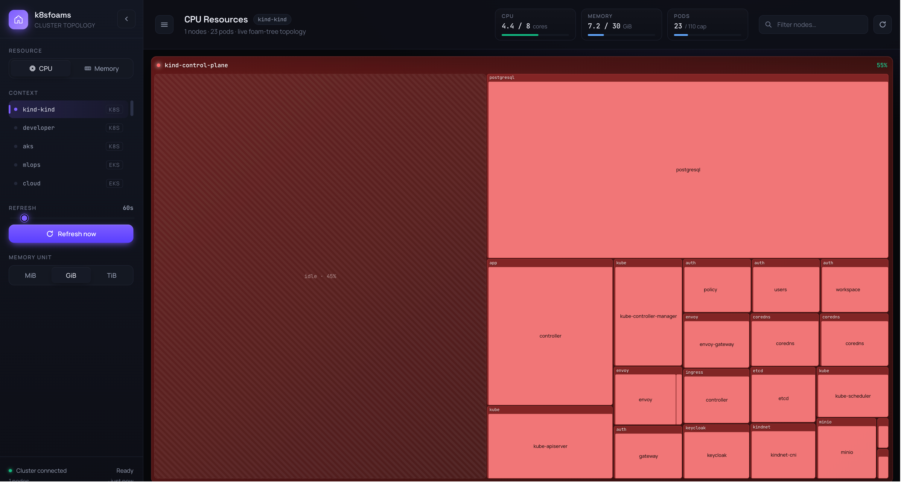

# 2D map

A squarified treemap. Each node is a box, each pod is a foam inside it, sized by its request. A pod with more than one
container is split into sub-foams. The striped *idle* foam is unused (free) capacity on that node. Pick **CPU** or
**Memory** with the *Resource* control, or an [extended resource](extended-resources.md) when the cluster has one.

<figure class="k8sfoam-embed">
  <iframe src="../demo/index.html?embed=1" loading="lazy" title="k8sfoams 2D map of the demo-shop cluster"></iframe>
  <figcaption>
    The 2D map of the demo-shop cluster. Hover a pod for its requests; click a node for its pod list.
    <a href="../demo/index.html" target="_blank">Open full screen</a>
  </figcaption>
</figure>

Things to try in the embedded map:

- **Hover a pod** to see its namespace, requests, QoS class and any audit findings.
- **Click a pod** to pin its workload: every replica of the same Deployment or StatefulSet glows across the cluster,
  and the header shows how many replicas run on how many nodes. `Esc` clears it.
- **Click a node header** to open its focus overlay: every pod with CPU and memory, the container breakdown, the
  node's taints and conditions, and the *Simulate drain* button.
- **Switch to Memory** in the sidebar (the ☰ button opens it) and watch the same pods resize.

The number in each node header is its utilisation of the selected resource, colour-coded blue, green, amber and red
as the node fills up.

